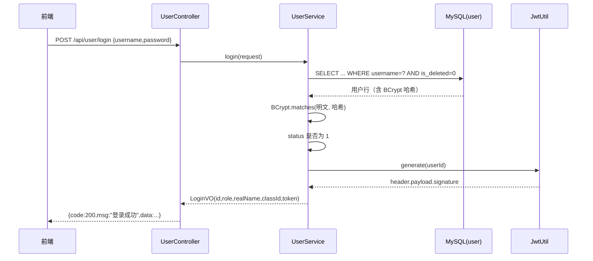
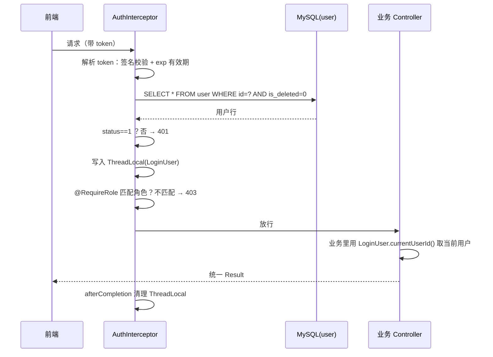

# 用户与权限模块设计说明（后端 1｜feature/user-auth）

> 课程实训成果管理平台 · SpringBoot 4.1.1 + Vue · JDK 21 + MySQL 8
> 本文档既是模块设计说明（可放入实训报告），也是**给全组联调用的接口契约与注意事项**。

---

## 一、模块定位与边界

### 1.1 我负责什么

| 序号 | 职责 | 对应交付物 |
|---|---|---|
| 1 | 用户模块后端代码：登录（学生/教师/管理员）、token 生成、权限校验 | `LoginUser`/`JwtUtil`/`AuthInterceptor`/`RequireRole`/`WebConfig` |
| 2 | 用户新增、分页查询、修改、逻辑删除；user 表数据库操作 | `UserController`/`UserService`/`UserRepository` |
| 3 | （附带）全组共用的基础设施 | `Result`/`PageResult`/`BusinessException`/`GlobalExceptionHandler` |

### 1.2 模块依赖关系

```
user-auth（我的）  ←─ 所有需要登录的接口都依赖它：登录拿 token、鉴权、取当前登录用户
    ↑
    ├── class 班级模块：依赖 user 表里的 teacher_id / 学生的 class_id
    ├── training-task 任务模块：依赖 create_user_id（当前登录教师）、class_id
    ├── submission 提交模块：依赖 student_id（当前登录学生）、教师评分时的身份
    ├── message 消息模块：依赖 user_id（接收人）
    └── 文件上传 / 成绩统计 / 分组 / 归档：都建立在"我知道当前是谁"之上
```

**结论：我的模块必须先合入 dev 分支并跑通，其他同学才能开工**，否则每个人都得自己写一遍登录鉴权。

### 1.3 包结构

```
com.util.demo2
├── common/   全组共用（改动需群里同步）
│   ├── Result                 统一返回体 {code,msg,data}
│   ├── PageResult             统一分页体 {records,total,current,size}
│   ├── BusinessException      业务异常（Service 直接 throw）
│   └── GlobalExceptionHandler 全局异常 → 统一返回体
├── auth/     登录与权限
│   ├── JwtUtil                HS256 JWT 签发与校验（手写，无第三方依赖）
│   ├── LoginUser              当前登录用户 + ThreadLocal 持有
│   ├── RequireRole            角色权限注解
│   └── AuthInterceptor        登录校验 + 权限校验拦截器
├── config/
│   ├── WebConfig              拦截器注册 + 跨域
│   ├── AppConfig              BCrypt PasswordEncoder Bean
│   └── AdminInitializer       首次启动初始化 admin 账号
└── user/
    ├── entity/User            user 表实体
    ├── dto/                   LoginRequest、UserSaveRequest
    ├── vo/                    LoginVO、UserVO
    ├── repository/UserRepository   user 表所有 SQL（JdbcTemplate）
    ├── service/UserService    业务规则
    └── controller/UserController  6 个 REST 接口
```

---

## 二、涉及的数据表

只用 `user` 表（并只读 class 表的 `id`/`is_deleted`/`class_name` 做校验与展示）：

| 字段 | 类型 | 本模块如何使用 |
|---|---|---|
| id | BIGINT | 主键，token 里只存这个 |
| username | VARCHAR(50) UNIQUE | 登录凭据、模糊查询条件；**修改接口不允许改它** |
| password | VARCHAR(100) | 存 BCrypt 哈希（`$2a$10$...`），**任何接口都不返回** |
| real_name | VARCHAR(50) | 展示、可修改 |
| role | VARCHAR(20) | `student`/`teacher`/`admin`，权限判断的唯一依据 |
| class_id | BIGINT | 学生所属班级；教师/管理员为 NULL |
| status | TINYINT | 0 禁用 1 启用；**禁用后旧 token 立即失效** |
| create_time / update_time | DATETIME | 数据库自动维护，接口里以 `yyyy-MM-dd HH:mm:ss` 字符串返回 |
| is_deleted | TINYINT | 逻辑删除标记，本模块所有查询显式带 `is_deleted = 0` |

---

## 三、接口清单

统一前缀 `/api`，统一返回体 `{code,msg,data}`，**HTTP 状态码恒为 200**，业务状态看 body 的 `code`。

### 3.1 权限矩阵

| 接口 | 方法 | admin | teacher | student | 未登录 |
|---|---|---|---|---|---|
| /api/user/login | POST | 匿名 | 匿名 | 匿名 | 匿名 |
| /api/user/page | GET | ✅ | ⚠️待确认 | ❌ 403 | 401 |
| /api/user/{id} | GET | ✅ 任何人 | 仅自己 | 仅自己 | 401 |
| /api/user | POST | ✅ | ❌ 403 | ❌ 403 | 401 |
| /api/user/{id} | PUT | ✅ 任何人 | 仅自己 | 仅自己 | 401 |
| /api/user/{id} | DELETE | ✅ | ❌ 403 | ❌ 403 | 401 |

### 3.2 登录 `POST /api/user/login`

请求：`{"username":"admin","password":"123456"}`

响应（注意 `id`/`classId` 是文档之外补的，前端登录后缓存它们）：

```json
{
  "code": 200,
  "msg": "登录成功",
  "data": {
    "id": 1, "username": "admin", "realName": "系统管理员",
    "role": "admin", "classId": null,
    "token": "eyJhbGciOiJIUzI1NiJ9.eyJzdWIiOiIxIiwiaWF0IjoxNzYwMzM2MDAwLCJleHAiOjE3NjAzNDMyMDB9.xxxxxx"
  }
}
```

失败：账号或密码错误 / 账号被禁用 → `{"code":401,"msg":"账号或密码错误","data":null}`（两种情况提示一致，避免被枚举账号）。

### 3.3 分页查询 `GET /api/user/page`

参数（除 current/size 外都可选）：`current`(默认1)、`size`(默认10，上限100)、`username`(账号模糊)、
`role`(student/teacher/admin)、`classId`(按班级筛人)、`status`(0 禁用 / 1 启用)。
`role`/`status` 传了非法值直接 400，不会返回"空列表"让前端猜。

```json
{
  "code": 200, "msg": "操作成功",
  "data": {
    "records": [{
      "id": 2, "username": "s001", "realName": "张三", "role": "student",
      "classId": 1, "className": "2025计算机1班", "status": 1,
      "createTime": "2026-10-13 10:20:31", "updateTime": "2026-10-13 10:20:31"
    }],
    "total": 1, "current": 1, "size": 10
  }
}
```

### 3.4 查询单个用户 `GET /api/user/{id}`

本人或 admin 可查，否则 403。

### 3.5 新增用户 `POST /api/user`

```json
{"username":"s001","password":"123456","realName":"张三","role":"student","classId":1}
```

校验链：账号非空且≤50 → 密码≥6 位 → 姓名非空且≤50 → 角色必须是 student/teacher/admin
→ classId 若传了必须真实存在 → 账号未被占用（包含"被已删除用户占用"）→ 密码 BCrypt 加密 → status 默认 1。
返回 `data` 为新用户 id。失败统一 400 并给出具体原因。

补充两条约定（本次收尾时明确，见变更记录）：

- `role=student` 时 `classId` **建议填但不强制**（班级模块 `/api/class` 未合入前需要先建人再分班，强制会卡住联调）；前端应在表单里让管理员选班级。
- `role=teacher/admin` 时 `classId` 一律被忽略，落库为 `NULL`——带班关系由 `class.teacher_id` 表示，避免同一件事出现两份数据。

### 3.6 修改用户 `PUT /api/user/{id}`

- **admin**：可改 `realName`、`role`、`classId`、`status`；带 `password` 则重置密码；`password` 留空/不传表示不改。
- **teacher / student**：只能改**自己**的 `realName` 和 `password`；请求体里若带了与自己当前不一致的 `role`/`status`/`classId`，直接 **403**（不是静默忽略，避免用户以为改成功）。
- `username` **不允许修改**：传了不同的值直接 400（前端原样回填相同账号仍然允许）。
- 护栏：不能禁用自己的账号；不能把最后一个管理员降级为其他角色；非学生角色改完后 `class_id` 自动置 NULL。
- **新密码在写库之前就完成校验与加密**（否则会出现"接口返回 400、数据却已经改了"的脏数据）；
  整个方法带事务，"改资料 + 改密码"两条 UPDATE 要么都成功要么都回滚。

### 3.7 逻辑删除 `DELETE /api/user/{id}`

`UPDATE user SET is_deleted = 1`，行仍在库里。护栏：不能删当前登录账号；不能删最后一个管理员；重复删除 400。

### 3.8 错误码约定

| code | 含义 | 触发场景 |
|---|---|---|
| 200 | 成功 | — |
| 400 | 参数/业务校验失败（**对规范的扩展，需全组认可**） | 账号已存在、密码过短、角色非法、用户不存在、删自己、最后一个管理员 |
| 401 | 未登录 / token 无效过期 / 账号被禁用或被删除 | 所有需要登录的接口 |
| 403 | 已登录但权限不足 | 学生查用户列表、非管理员改别人的 role 等 |
| 500 | 服务器异常 | 未捕获异常（堆栈只写日志，不返回给前端） |

---

## 四、核心流程

### 4.1 登录与签发 token



### 4.2 每次请求的鉴权流程



**关键点：token 里只放 userId，角色/状态每次回查数据库**，所以改角色、禁用账号、删除账号**立即生效**，不用等 token 过期，也不需要"强制下线"功能。

### 4.3 逻辑删除的影响链

删除用户后：该用户 id 的 token 全部失效（401）、不再出现在分页结果、不能再次登录；但 `username` 的唯一索引**仍被占用**，因此同名账号无法重建——这是 MySQL 唯一索引与逻辑删除的固有冲突，见第十节。

---

## 五、关键设计决策（答辩可讲）

| 决策 | 理由 |
|---|---|
| 手写 HS256 JWT，不引 jjwt | 工程是 Boot 4 + Jackson 3，而 jjwt 依赖 Jackson 2，混用有序列化冲突风险；手写只需 JDK 的 HMAC，零依赖 |
| token 只存 userId，角色回查数据库 | 权限变更/禁用/删除立即生效；token 泄露的影响面更小 |
| 签名比较用 `MessageDigest.isEqual` | 恒定时比较，避免签名被逐字节爆破的时序攻击 |
| 用 `spring-boot-starter-jdbc` + JdbcTemplate，不用 MyBatis-Plus | MyBatis-Plus 主线面向 Boot 3.x，Boot 4 兼容性未验证；课程项目里跑不起来代价太大。SQL 显式书写，逻辑删除条件不会被框架隐藏 |
| 密码 BCrypt | 自带盐、可调强度，不可逆；禁止明文/MD5 |
| 一律 HTTP 200 + body code | 前端 axios 只需判断 `res.data.code`，一处逻辑管全部错误；避免"401 有时在 HTTP 头、有时在 body"的双轨混乱 |
| 非管理员越权修改直接 403 而不静默忽略 | 静默忽略会让前端以为保存成功，是最难查的一类 bug |
| 查询显式带 `is_deleted = 0` | 不依赖任何框架的自动拼接，SQL 可读可审 |
| 登录失败提示不区分"账号不存在/密码错误" | 防止攻击者枚举系统内有哪些账号 |

---

## 六、测试情况

| 层级 | 资产 | 覆盖 |
|---|---|---|
| 单元测试（Mock，不连库） | `.../UserServiceTest.java`（35 例） | 登录各分支、BCrypt 加密、提权 403、改别人 403、账号不可修改、**新密码过短必须在写库前被拒绝**、角色与班级一致性、不能删自己、不能删/降级最后一个管理员、逻辑删除 |
| 单元测试（Mock，不连库） | `.../UserServicePageTest.java`（8 例） | 分页偏移量、脏参数夹紧（current=0、size=999999→100）、账号/角色/班级/状态过滤、总数为 0 不查列表、实体转 VO、UserVO 无 password 字段 |
| 单元测试（Mock，不连库） | `.../AuthInterceptorTest.java`（13 例） | 无 token / 篡改 token / 过期 → 401；被禁用、被删除后旧 token 立即失效；角色以数据库为准；403 权限拦截；LoginUser 写入与清理；两种请求头 |
| 单元测试（Mock，不连库） | `.../JwtUtilTest.java`（8 例） | 签发/解析、payload 篡改、换密钥、过期、空/格式错误、密钥过短 |
| 接口契约（MockMvc，不连库） | `.../UserApiContractTest.java`（16 例） | Controller + @Valid + 全局异常 + 拦截器整条链路：返回体结构、401/403/400、分页 data 形态、非法 JSON、参数类型错误、`password:""` 可保存 |
| **集成测试（真连 MySQL）** | `.../UserRepositoryDbTest.java`（13 例） | 每条 SQL 真库执行：自增主键、`create_time` 默认值、`class_id` NULL 读成 null、逻辑删除后查不到但行在、账号占用判断、`existsClass`、`countByRole`、分页四过滤 + 倒序 + LIMIT/OFFSET + LEFT JOIN、`update` 写 SQL NULL、`updatePassword`、重复删除影响 0 行 |
| **集成测试（真连 MySQL）** | `.../UserServiceDbTest.java`（16 例） | 完整链路：真哈希登录、新增即能登录、禁用后登不上、唯一索引冲突仍是 400、教师 class_id 落 NULL、改姓名/重置密码真落库、空密码哈希不变、短密码不碰库、最后一个管理员护栏、真库分页、逻辑删除、**禁用/删除后旧 token 立刻 401**、角色取自数据库 |
| 启动冒烟（连库） | `.../Demo2ApplicationTests.java`（1 例） | Spring 容器装配 + `AdminInitializer` 真查库（需要 MySQL 已启动） |
| 端到端（真库 + 真 HTTP） | `api-test.ps1`（51 条断言） | 11 组场景：登录、无/伪造 token、登录失败分支、分页边界、新增与 4 类参数校验、越权访问、提权防护、禁用后 token 失效、重置密码、业务护栏、逻辑删除与同名占用（需启动应用） |

**实测结果（2026-10-13，本机 MySQL 已启动）**：

```
mvn -B -o test
Tests run: 110, Failures: 0, Errors: 0, Skipped: 0
BUILD SUCCESS

api-test.ps1 → 全部通过：51 项
```

- 80 例走 Mock（秒级、不依赖环境），29 例真连 MySQL，1 例容器冒烟；
- 真库集成测试类上标 `@Transactional`，**每个用例结束自动回滚**，实测跑完 `user` 表仍只有 admin、`class` 表仍为 0 行，不污染开发库；
- 测试数据统一用 `it_<随机串>_` 前缀，不会与真实数据或历史遗留数据撞名（username 有唯一索引，且逻辑删除不释放唯一索引）。

运行方式见 `README-user-auth.md` 第 3 节。

---

## 七、与其他模块的接口契约（组员必读）

### 7.1 怎么取"当前登录用户"——**不要相信前端传来的 id**

```java
import com.util.demo2.auth.LoginUser;

Long me = LoginUser.currentUserId();      // 当前登录用户 id
String role = LoginUser.currentRole();    // student / teacher / admin
LoginUser user = LoginUser.get();         // 完整信息：id/username/realName/role/classId
user.isAdmin();  user.isTeacher();  user.getClassId();
```

各模块正确用法：

| 模块 | 用法 |
|---|---|
| submission 提交成果 | `studentId` **必须**用 `LoginUser.currentUserId()`，绝不能取前端传的 studentId（否则学生能替别人提交/伪造记录） |
| training-task 创建任务 | `create_user_id` 用 `LoginUser.currentUserId()` |
| 教师评分 | 评分前校验 `LoginUser.currentRole()` 是 teacher/admin，且该提交属于自己所带班级 |
| 成绩统计 | 教师只能用 `LoginUser.get().getClassId()` 限定的范围统计，防止越班看数据 |
| 消息 | 接收人 `user_id` 用 `LoginUser.currentUserId()` 查自己的消息 |

### 7.2 统一返回体与分页体：**用 common 包里的，不要各自复制一份**

```java
return Result.success(data);                       // {"code":200,"msg":"操作成功","data":...}
return Result.success("新增成功", id);
throw new BusinessException("任务已截止，不能提交");     // → 400
throw new BusinessException(Result.CODE_FORBIDDEN, "只能给本班学生评分");
return Result.success(PageResult.of(records, total, current, size));   // 分页固定四字段
```

### 7.3 权限注解

```java
@RequireRole({"teacher", "admin"})   // 方法或类上，不写=只要登录就能访问
```

### 7.4 不需要登录的接口怎么办

在 `config/WebConfig.java` 的 `excludePathPatterns` 里加，目前只放行了 `/api/user/login`。**这个文件是全组共享的**，要加白名单请在群里说一声，避免多人同时改造成合并冲突。

---

## 八、综合联调注意事项（全组）

### 8.1 联调第一天必须先定下来的 3 件事

| # | 事项 | 现状 | 不定会怎样 |
|---|---|---|---|
| 1 | token 放哪个请求头 | 两份文档冲突：《统一接口规范》写 `token: xxx`，《接口文档》写 `Authorization: Bearer {token}`。我的代码**两种都收**，但前端只能发一种 | 前端发 A、后端只认 B → 全员 401，联调直接卡住 |
| 2 | HTTP 状态码与 body code 的关系 | 我的实现：**永远 HTTP 200**，业务码在 body | 前端若按 HTTP 401 跳登录，永远不会触发 |
| 3 | 400 错误码是否被接受 | 我在 200/401/403/500 之外加了 400 = 参数/业务校验失败 | 若全组坚持只用 4 个码，业务失败只能返回 500，前端会统一弹"服务器异常"，用户看到的是"系统坏了"而不是"账号已存在" |

### 8.2 容易互相踩的坑（按重要程度）

1. **前端的 axios 拦截器只写一次**（6 号对接员）：`res.data.code === 401` → 清 token 跳登录；`403` → 提示无权限；`400` → 直接显示 `msg`；`500` → 提示服务器异常。
2. **分页结构不要各自造轮子**：有人用 `records/total/current/size`，有人直接把 MyBatis-Plus 的 `Page` 序列化（会多出 `pages/searchCount/optimizeCountSql/orders` 等字段），前端就要写两套解析。
3. **跨域只能有一处生效**：我已开 `WebConfig.addCorsMappings`。如果前端改用 Vite 的 `server.proxy` 代理，就不需要跨域；**不要**再有同学在 Controller 上各自加 `@CrossOrigin`，否则会出现重复响应头。
4. **合并冲突高发文件**：`pom.xml`、`config/WebConfig.java`、`common/` 包、`application.properties`。约定：先合我的 user-auth，其他人从 dev 拉最新再开发；谁改共享文件在群里说。
5. **数据库结构必须全员一致**：以仓库里的 `create-database.sql` 为准。任何同学改表（加字段/加索引）都要同步提交 SQL 并通知全组，否则别人本地会出现 `Unknown column` 或字段长度不足。
6. **每个人本地都要改自己的数据库密码**：`application.properties` 里的密码不要提交真实值（建议本地用 `application-local.properties` 并加进 `.gitignore`），`app.jwt.secret` 也不要写死真实密钥。
7. **不要提交 `target/` 和构建产物**（`.gitignore` 已包含则忽略）。
8. **查询必须带 `is_deleted = 0`**：其他模块自己写 SQL 时最容易漏；漏了的症状是"删掉的班级/任务还在列表里"。
9. **时间格式统一**：接口输出统一 `yyyy-MM-dd HH:mm:ss` 字符串（本模块已如此），前端不要自己再转；JDBC URL 里已带 `serverTimezone=Asia/Shanghai`，别改。
10. **主键是 BIGINT 自增**：目前从 1 开始没问题；若后期改用雪花 ID，前端 JS 会精度丢失（超过 2^53），到时候要配 `@JsonSerialize(using = ToStringSerializer.class)`。
11. **技术栈要统一决策**：如果其他同学想用 MyBatis-Plus，必须在联调前确认它对 Spring Boot 4 的支持（我的判断是有风险）；要么全组用 JdbcTemplate/MyBatis，要么统一把 Boot 降到 3.5.x，不能一半一半。
12. **启动顺序**：`user-auth` 是所有接口的前提，联调时后端由一个人统一启动（避免多人抢 8080 端口），前端各自指向同一个地址。

### 8.3 建议的联调顺序（按依赖）

```
1. user-auth（登录拿 token、鉴权）           ← 必须最先
2. class（班级：依赖 teacher_id）
3. training-task（任务：依赖 class_id + create_user_id）
4. submission（提交：依赖 task_id + student_id）→ 同时打通文件上传
5. message（消息）
6. 成绩统计 / 分组管理 / 成果归档
```

### 8.4 联调前的造数据顺序

```sql
-- 1. admin 由 AdminInitializer 自动创建（admin/123456）
-- 2. 用 admin 调接口依次创建：教师 → 班级（指定 teacher_id）→ 学生（指定 class_id）
-- 3. 用教师账号创建实训任务，用学生账号提交成果、教师评分
-- 对应接口（我的模块）：POST /api/user、POST /api/class、GET /api/user/page 核对
```

### 8.5 数据量上来后可能暴露的性能问题（建库脚本缺口）

| 表 | 缺什么 | 症状 | 建议 |
|---|---|---|---|
| submission | `task_id`、`student_id` 无索引 | 教师评分页、学生成果列表变慢（全表扫） | 加两个普通索引 |
| submission | 无 `UNIQUE(task_id, student_id)` | 同一学生同一任务能插多条提交记录 | 加唯一键，但要先解决逻辑删除与唯一键的冲突 |
| training_task | `class_id` 无索引 | 按班级筛任务变慢 | `KEY idx_task_class(class_id)` |
| message | 无 `(user_id, is_read)` 索引 | 未读数统计慢 | 加联合索引 |
| user | `class_id`、`role` 无索引 | 教师查本班学生、按角色统计慢 | 加索引 |
| 全部表 | `is_deleted` 允许 NULL | `WHERE is_deleted = 0` 会漏掉 NULL 行，数据"凭空消失" | 改成 `NOT NULL DEFAULT 0` |

### 8.6 已知的 schema 设计约束（需求变动时要一起评估）

- `training_task.class_id NOT NULL` → 一个任务只能挂一个班；若需求要"一个任务发给多个班"，需加 `task_class` 关联表。
- `user.username` 唯一 + 逻辑删除 → 删掉的账号名无法复用（本模块已给出友好提示，但方案本身需组内定）。
- `user` 与 `class` 互相引用（user.class_id ↔ class.teacher_id）→ 无法在 `CREATE TABLE` 时加外键，要加只能建表后 `ALTER`；当前全库无外键，靠索引 + 业务代码保证一致性。

---

## 九、待确认事项（影响联调，务必回复）

| # | 事项 | 影响 | 我的默认实现 |
|---|---|---|---|
| 1 | token 请求头用 `token:` 还是 `Authorization: Bearer` | 全员联调是否卡在 401 | 两种都支持 |
| 2 | 是否接受新增的 400 错误码 | 前端错误提示质量 | 已用 400 |
| 3 | **教师能否查询用户列表（本班学生）** | 分组管理、成绩统计模块是否需要新接口 | 目前 `/api/user/page` 仅 admin；如需要，改一个注解 + Service 加班级过滤 |
| 4 | 登录返回体补 `id`/`classId` 是否接受 | 前端是否要额外查一次 | 已补 |
| 5 | 是否需要"启用/禁用""重置密码"独立接口 | 前端列表页的交互 | 目前合并在 `PUT /api/user/{id}` |
| 6 | 是否需要"退出登录/强制下线" | token 目前无状态，无法主动失效（除禁用/删除账号） | 未实现 |
| 7 | 逻辑删除的 username 占用怎么处理 | 影响管理员日常使用体验 | 已给出友好提示，方案待定 |
| 8 | 学生是否必须挂在班级下 | 影响"按班级查学生、成绩统计"的数据完整性 | 目前允许 `class_id` 为 NULL（班级模块未合入时否则建不出学生），建议前端"新增学生"表单把班级设为必选，等 `/api/class` 合入后再决定是否改成后端强制 |

---

## 十、变更记录

| 日期 | 内容 |
|---|---|
| 2026-10-13 | 首版：接口 6 个、JwtUtil/LoginUser/AuthInterceptor/RequireRole、Result/PageResult/全局异常、单测 22 例 + 端到端脚本 49 条断言；编译验证通过 |
| 2026-10-13（收尾） | ①修复 `update()` **先写库后校验新密码**（会出现"接口 400 但数据已改"），密码改为写库前校验，`create/update/delete` 加 `@Transactional`；②非学生角色的 `class_id` 强制置 NULL（与本节字段表一致）；③`username` 变更由静默忽略改为显式 400；④`/api/user/page` 新增 `role`/`status` 过滤参数；⑤非法 JSON、参数类型错误由 500 改为 400；⑥`UserRepository.update()` 显式 `setNull(Types.BIGINT)`；⑦新增 `UserServicePageTest`/`AuthInterceptorTest`/`UserApiContractTest` 并补齐 `UserServiceTest`（**6 类 81 例全绿**） |
| 2026-10-13（接真库） | ⑧`Demo2ApplicationTests` 去掉"避开数据库"的配置，改回真连库（需要 MySQL 已启动）；⑨新增**真连 MySQL** 的 `UserRepositoryDbTest`（13 例，把每条 SQL 在真库跑一遍）与 `UserServiceDbTest`（16 例，真库 + 真 JdbcTemplate 的完整业务链路），类上 `@Transactional` 跑完自动回滚、不留测试数据；⑩修复 `api-test.ps1` 在 Windows PowerShell 5.1 下把 UTF-8 响应按 ISO-8859-1 解码导致的中文乱码（后端返回的是标准 UTF-8），并把脚本存为 UTF-8 with BOM。最终：**8 个测试类 110 例全绿 + 端到端 51 条断言全部通过** |
